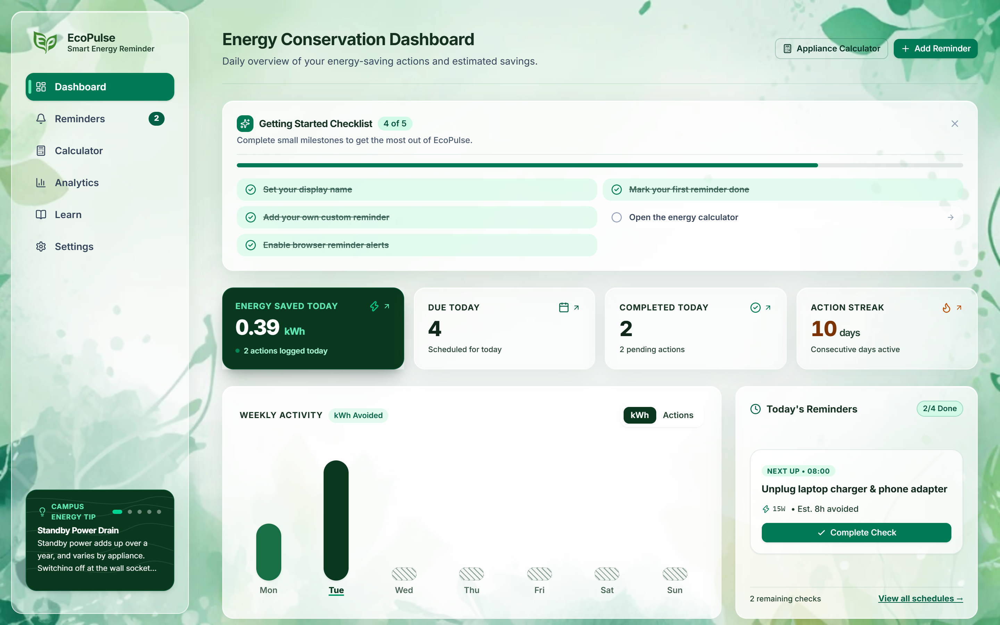
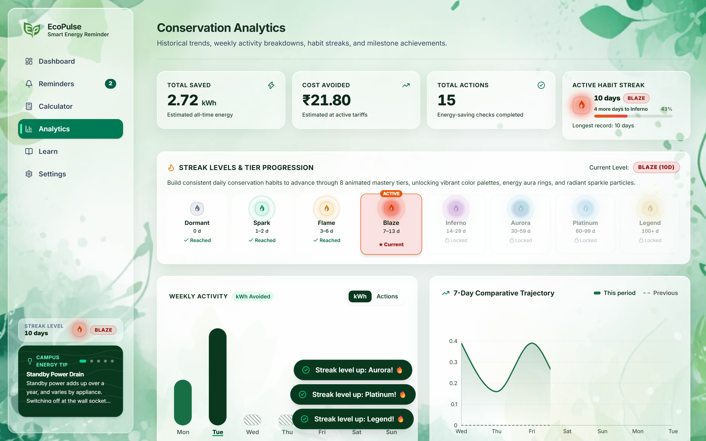
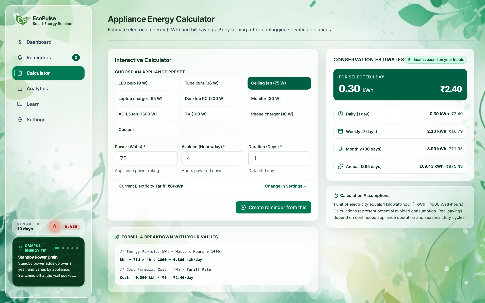
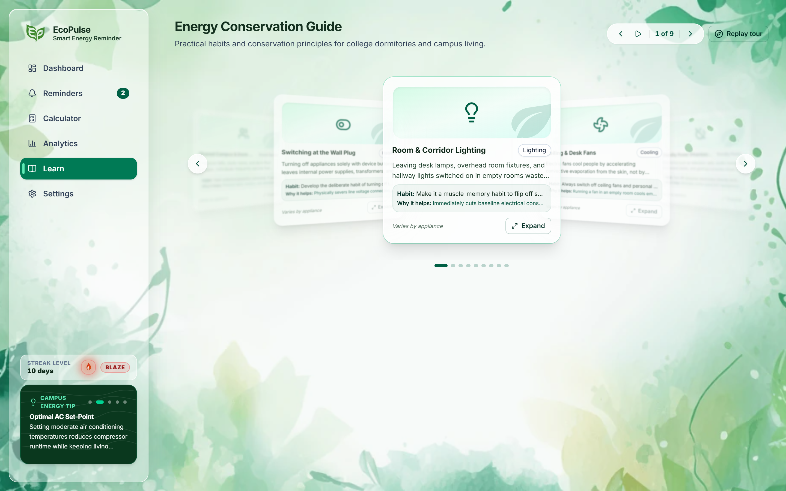
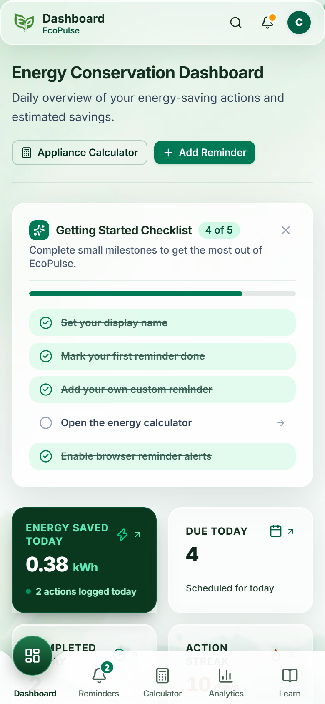
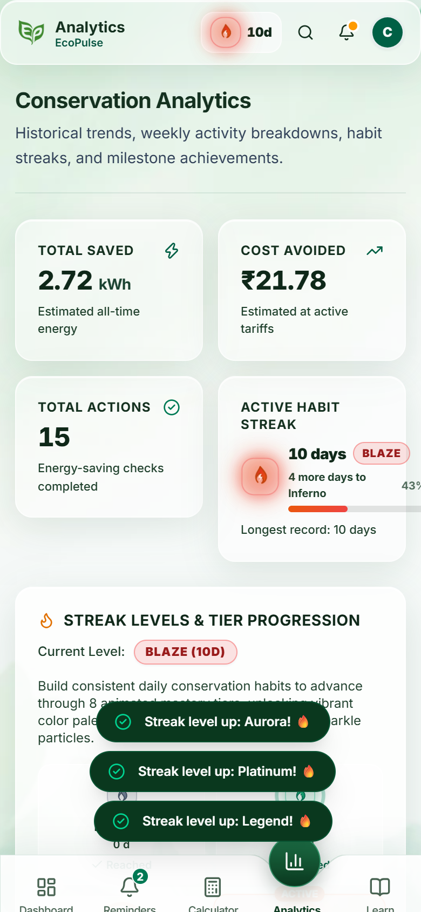

<div align="center">
  
  <h1>EcoPulse</h1>
  <p><strong>Smart Energy Saving Reminder</strong></p>
  <p><em>Small reminders, real habits. Track and reduce energy waste without invasive hardware.</em></p>
  <br />
  <p>
    <a href="https://eco-pulse-flame.vercel.app/" target="_blank">
      
    </a>
    
    
  </p>
  <p>
    🌐 <strong>Live URL:</strong> <a href="https://eco-pulse-flame.vercel.app/">https://eco-pulse-flame.vercel.app/</a>
  </p>
</div>

> **Course:** CHE110 — Environmental Studies Group Project  
> **Target Submission Date:** 20 October 2026  
> **Status:** Production-Ready Client-Side Progressive Web App (PWA)

---

## 📸 Application Screenshots

### Desktop Experience
| Dashboard & Action Tracker | Conservation Trends & Analytics |
|:---:|:---:|
|  |  |

| Standalone What-If Energy Calculator | 3D Interactive Habit Hub |
|:---:|:---:|
|  |  |

### Mobile Experience (Installable PWA)
| Mobile Dashboard | Mobile Analytics & History |
|:---:|:---:|
|  |  |

---

## 1. Project Purpose & The Environmental Problem

Electricity generation accounts for a substantial proportion of global fossil fuel combustion, greenhouse gas emissions, and industrial water cooling demands. On college campuses and in residential settings, a significant fraction of electrical energy is lost to **passive behavioral waste**:
- Study room and classroom lights remaining on when rooms are unoccupied.
- Ceiling and personal fans spinning in empty rooms (fans cool human skin, not air).
- Laptops, monitors, and chargers continuously drawing vampire/standby power around the clock.

Because individual students rarely see real-time utility bills or metering data, there is a lack of feedback connecting small daily habits to environmental impact. **EcoPulse** bridges this gap by providing an intuitive, transparent, and privacy-respecting reminder and tracking system that encourages mindful electricity conservation without requiring invasive IoT hardware.

---

## 2. Key Features

- **Customizable Reminder Engine:** Set daily, weekday, weekly, or one-time prompts across 8 appliance categories (lighting, cooling, chargers, computing, appliances, standby power, shared spaces, and other).
- **Light Glassmorphic Botanical Design:** Nature-inspired translucent light theme styled with tailored CSS glass tokens over layered botanical leaf artwork.
- **Offline Support & Installable PWA:** Full Progressive Web App powered by `vite-plugin-pwa` and Workbox (`generateSW` with `autoUpdate`, `skipWaiting: true`, and `clientsClaim: true`). Pre-caches all built static application bundles, styling, fonts, and botanical media for complete offline capability. Note: Because EcoPulse operates entirely client-side without a remote push server, due reminder alerts and audio chimes trigger via local browser timers while the application tab remains open or minimized, rather than when the browser application is completely closed.
- **Configurable Multi-Currency Selector:** Built-in settings currency selector supporting `₹ INR`, `$ USD`, `€ EUR`, and `£ GBP`. Dynamically applied across dashboard badges, energy calculators, trend cards, and history logs.
- **Reliable In-App Due Alerts:** Floating glass toast banner with immediate action buttons (*Mark Done*, *Snooze 15 min*, and *Dismiss*) and accessible `aria-live="polite"` announcements.
- **Native Browser Notifications:** Optional desktop notifications triggered when due reminders fire, automatically bringing the browser tab to focus on click.
- **Standalone Energy Calculator:** What-if estimation tool with 10 appliance presets (LED bulb, tube light, ceiling fan, laptop charger, desktop PC, monitor, AC 1.5 ton, TV, phone charger, custom). Displays real-time step-by-step formula substitutions across daily, weekly, monthly, and annual horizons, with a 1-click button to prefill custom reminders.
- **Conservation Analytics & Trends:**
  - Weekly Mon–Sun bar chart (Recharts) toggling between estimated kWh saved and completed actions.
  - Week-over-week comparative cards (this week vs. last week).
  - Habit streak counter (current active streak and all-time record).
  - Dynamic milestone achievement badges (never stored, derived live from activity).
  - Reverse-chronological action history grouped by date with "Show more" pagination.
- **Interactive 3D Learn Hub:** Glassy 3D carousel powered by `motion` springs, perspective depth, wrap-around navigation, control pill with play/pause, touch drag, keyboard navigation, and dialog expansions for 9 practical conservation habits.
- **Data Portability (Export & Import):** Instant JSON backup export and validated schema import, enabling effortless data preservation and migration across browsers.
- **Route Code-Splitting:** Dynamic `React.lazy` routing with custom glass loading fallbacks ensuring sub-300 kB initial bundle size for rapid first contentful paint.
- **Presentation Demo Data:** Settings toggle to load ~14 days of realistic demonstration completions clearly flagged as `isDemo: true`, allowing complete evaluation without compromising authentic user history.
- **Local Client Storage:** Pure browser `localStorage` persistence with backward-compatible schema migration (v1 to v2) and full data reset controls.

---

## 3. Technology Stack

- **Framework:** React 19 + TypeScript (Strict Mode)
- **Build Tool:** Vite 8
- **PWA & Offline:** `vite-plugin-pwa` (Workbox Service Worker + Auto-Update)
- **Styling:** Tailwind CSS v4 + Vanilla CSS glassmorphic tokens
- **Animations:** Motion 14 (spring physics & 3D carousel transforms)
- **Data Visualization:** Recharts 3
- **Icons:** Lucide React
- **Typography:** Geist Sans (`@fontsource/geist-sans`) for clean UI hierarchy and Geist Mono (`@fontsource/geist-mono`) for tabular numeric data (SIL Open Font License)
- **Testing:** Vitest 5 (26 test files, 171 tests)
- **Linter:** Oxlint
- **Browser Automation:** Playwright (Mobile/desktop viewport audit & automated screenshot captures)

---

## 4. How It Works & Calculation Formulas

EcoPulse evaluates scheduled reminders against the current local calendar date (avoiding UTC timezone offset anomalies). When an action is checked off, the system snapshots the reminder title and evaluates the energy avoided based on the appliance's rated power and estimated avoided operating hours.

### Formulas
1. **Electrical Energy Avoided (kWh):**
   $$\text{kWh} = \frac{\text{Watts (W)} \times \text{Hours avoided (h)}}{1000}$$
2. **Estimated Financial Savings:**
   $$\text{Cost Saved} = \text{kWh} \times \text{Tariff Rate (Currency/kWh)}$$

*Note: The default tariff is set to ₹8.00 per unit (kWh), representative of typical domestic utility slabs in India, and can be customized alongside the chosen currency symbol (₹, $, €, £) in Settings.*

---

## 5. Honest Architecture & System Limitations

EcoPulse adheres to strict academic honesty and technical transparency:
1. **User-Reported Verification:** The system relies on self-reported action completions; it does not interface with smart meters or current-sensing hardware.
2. **Estimates Only:** kWh calculations are theoretical estimates derived from user-specified appliance wattage labels and user-reported avoided usage times.
3. **Tab Lifecycle Constraints:** Browser notifications and alerts execute on client-side timers. Alerts fire while EcoPulse is running in an open or minimized browser tab. Because EcoPulse is privacy-first with no remote push server, alerts cannot fire when the browser is completely shut down.
4. **Device-Local Storage:** All preferences, reminders, and history reside strictly inside browser `localStorage`. Data does not synchronize across separate devices unless migrated via the JSON Export/Import feature.

---

## 6. Installation & Local Development

### Prerequisites
- Node.js (v18 or higher recommended)
- npm (v9 or higher)

### Setup & Run Commands

1. **Clone the repository:**
   ```bash
   git clone https://github.com/vardansharma2912-dotcom/EcoPulse-energy-saver.git
   cd EcoPulse-energy-saver
   ```

2. **Install dependencies:**
   ```bash
   npm install
   ```

3. **Start the local development server:**
   ```bash
   npm run dev
   ```
   Open `http://localhost:5173` in your browser.

4. **Run automated unit tests:**
   ```bash
   npm test
   ```

5. **Run linter checks:**
   ```bash
   npm run lint
   ```

6. **Build for production:**
   ```bash
   npm run build
   ```

7. **Preview the production build locally:**
   ```bash
   npm run preview
   ```

8. **Capture automated UI screenshots (Playwright):**
   ```bash
   node scripts/capture-screenshots.mjs
   ```

> [!NOTE]
> **Static 404 Routing (`public/404.html`):**  
> EcoPulse includes both an in-app catch-all 404 page (`/#/*`) for hash-route navigation and a self-contained static `public/404.html` for unknown real paths served by hosting platforms like Vercel.

---

## 7. Project Structure

```
EcoPulse/
├── docs/                   # App screenshots, logos, and presentation assets
├── public/                 # Static web assets (manifest, service worker icons, 404.html)
├── scripts/
│   ├── capture-screenshots.mjs # Automated Playwright desktop/mobile screenshot capturer
│   └── mobile-audit.mjs    # Automated Playwright responsive viewport & accessibility audit
├── src/
│   ├── assets/             # Botanical leaf background assets (leaf-bg.webp, logo)
│   ├── components/
│   │   ├── charts/         # Recharts wrappers & custom bar charts
│   │   ├── layout/         # Navigation, AppLayout, PageHeader, LeafBackground, InAppAlertBanner
│   │   ├── reminders/      # Reminder cards, lists, dialogs, action buttons
│   │   ├── tour/           # Onboarding interactive walkthrough dialog
│   │   └── ui/             # Glass cards, buttons, badges, inputs, dialogs, count-ups
│   ├── lib/
│   │   ├── __tests__/      # Vitest suites (alerts, analytics, dates, energy, storage, etc.)
│   │   ├── alerts.ts       # Alert detection & deduplication logic
│   │   ├── analytics.ts    # Chart aggregation, streak, badge, and comparison pure functions
│   │   ├── dates.ts        # Local timezone calendar date utilities
│   │   ├── energy.ts       # Energy conversion & financial math
│   │   ├── notifications.ts # Browser notification dispatching & permission handling
│   │   ├── sampleData.ts   # Demonstration data generator & demo filters
│   │   ├── schedule.ts     # Recurrence rules & due date evaluation
│   │   └── storage.ts      # LocalStorage layer, currency migration & JSON export/import
│   ├── pages/
│   │   ├── DashboardPage.tsx   # Daily overview, metrics, due actions, quick add
│   │   ├── RemindersPage.tsx   # Full reminders management CRUD
│   │   ├── CalculatorPage.tsx  # Standalone appliance what-if calculator
│   │   ├── AnalyticsPage.tsx   # Weekly Recharts bar graph, streaks, badges, history
│   │   ├── LearnPage.tsx       # 3D habit carousel with conservation guides
│   │   ├── SettingsPage.tsx    # Currency, tariffs, notifications, export/import, demo data
│   │   └── NotFoundPage.tsx    # Catch-all glass 404 view
│   ├── state/              # Global React Context, action types & reducer
│   ├── App.tsx             # Root router configuration (HashRouter + React.lazy code-splitting)
│   ├── index.css           # Tailwind v4 theme, glassmorphic utility tokens
│   ├── main.tsx            # Application entrypoint & PWA service worker registration
│   └── types.ts            # Core TypeScript interfaces & data models
├── package.json
├── tsconfig.json
└── vite.config.ts          # Vite build config, Workbox PWA setup & rollup chunking
```

---

## 8. 🗺️ Roadmap

- [ ] **Cloud Synchronization:** Opt-in end-to-end encrypted synchronization across user devices (e.g., via Supabase or decentralized storage).
- [ ] **True Background Push Notifications:** Serverless edge cron triggers utilizing the Web Push Protocol to deliver notifications even when the browser is completely closed.
- [ ] **Dormitory & Team Challenges:** Multi-room energy-saving competitions with shared leaderboards for college hostels and residential floors.
- [ ] **Report Export (PDF / CSV):** One-click generation of formatted monthly sustainability impact reports for academic submission or campus green initiatives.

---

## 9. Presentation & Academic Submissions

- **Live Application URL:**  
  [https://eco-pulse-flame.vercel.app/](https://eco-pulse-flame.vercel.app/)

- **Interface Screenshots:**  
  All high-resolution desktop and mobile captures are located in the [docs/](file:///d:/Projects/CHE110/EcoPulse/docs) directory.

- **Group Member Contributions (CHE110 Group Project):**  
  - **Vardaan** — Lead Developer & Architecture  
  - **Shashank** — Research & Calculations  
  - **Raina Deep** — Environmental Studies & Content  

- **Asset & Artwork Credits:**  
  - Icons: [Lucide Icons](https://lucide.dev)  
  - Fonts: Geist Sans & Geist Mono by Vercel via [@fontsource/geist-sans](https://fontsource.org/fonts/geist-sans) and [@fontsource/geist-mono](https://fontsource.org/fonts/geist-mono) (SIL Open Font License)  
  - Watercolor Botanical Artwork: EcoPulse Design System (`src/assets/leaf-bg.webp`)  
  - Vector Brand Identity: EcoPulse Design System (`public/favicon.svg`, `public/icon-512.png`)  

---

## 10. License

Developed for educational and environmental studies academic purposes (CHE110). Open for student and campus sustainability research.
